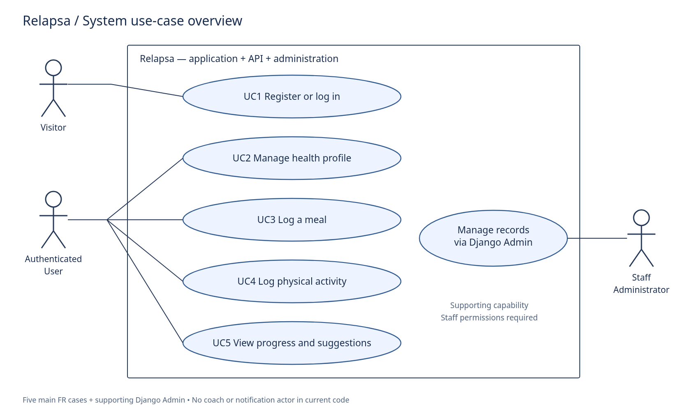
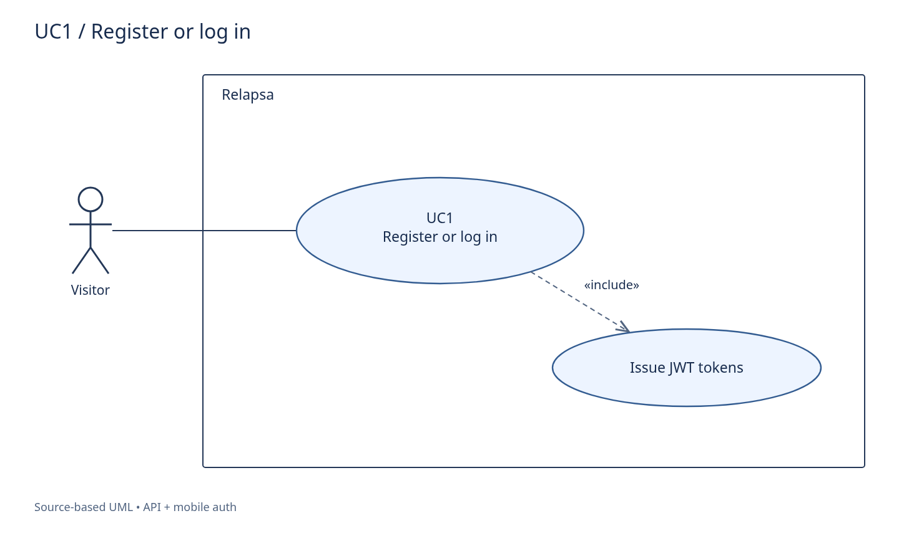
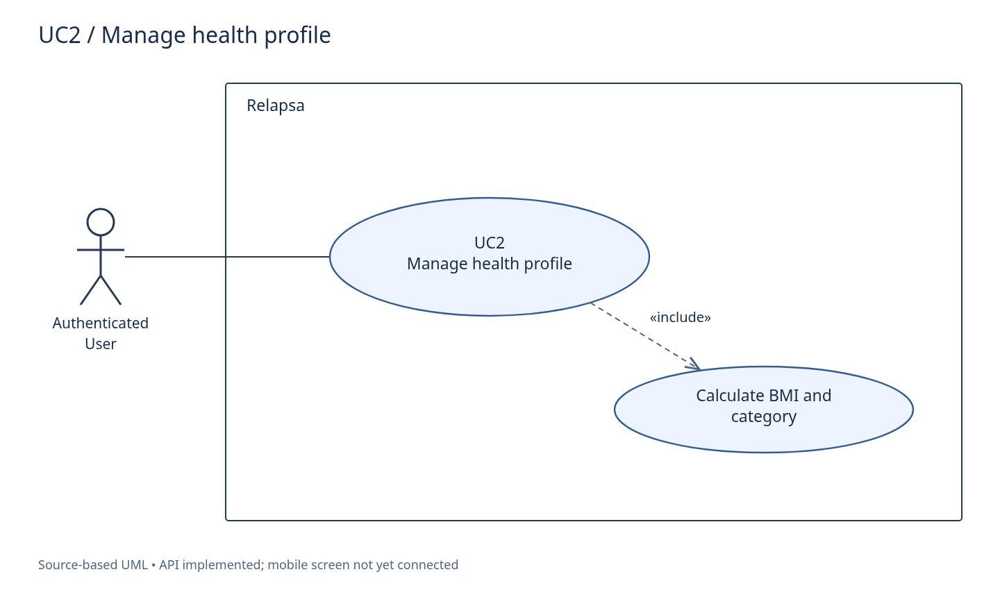
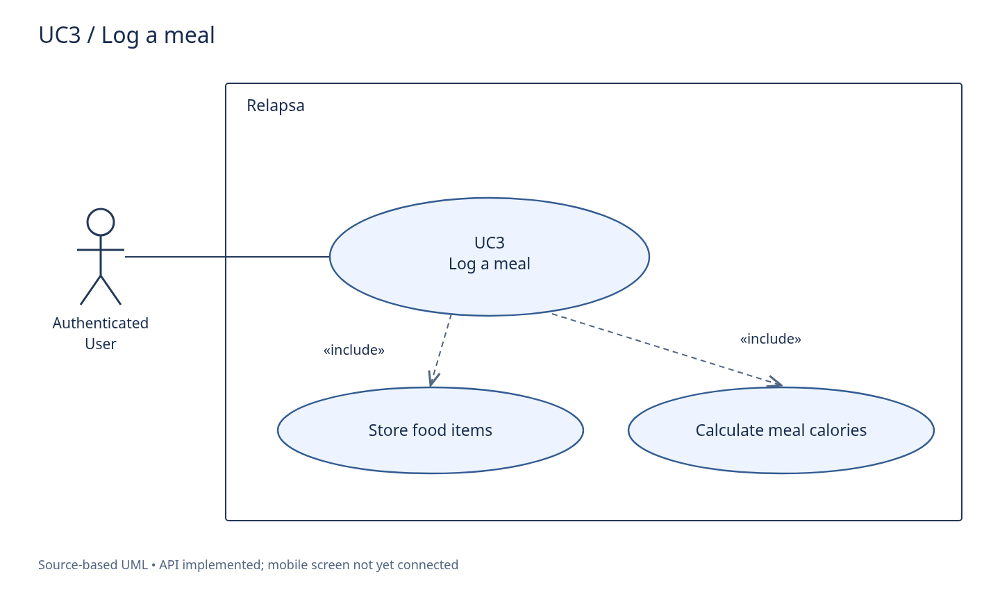
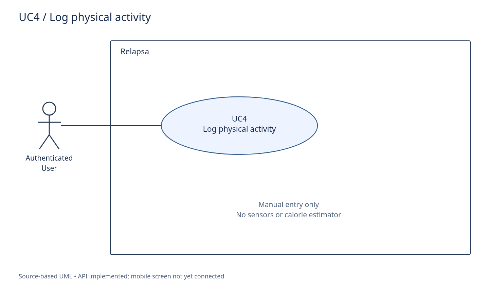
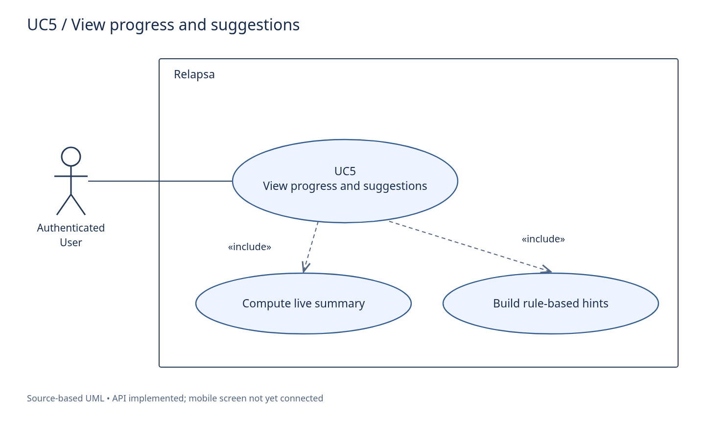

# Relapsa — Use-case specifications

Five main cases trace to the numbered requirements in [01-SRS.md](01-SRS.md). Identifiers follow code; Persian actor names are supplied for classroom use. “Implemented” means present in source, not deployment-tested.

## Actors

- **Visitor:** person registering or logging in.
- **Authenticated User:** person using protected personal-data APIs; same person after successful authentication.
- **Staff Administrator (مدیر سیستم):** uses Django Admin with staff status and required model permissions. All seven domain models are registered. This supporting admin capability is shown in the overall diagram, not counted among the five FR cases.
- No coach, notification system, wearable or external identity provider is an implemented actor. JWT, database and internal services are inside the system boundary.

## UC1 — Register or log in

| Item | Specification |
|---|---|
| ID | UC1 |
| Name | Register or log in |
| Primary actor | Visitor (کاربر مهمان) |
| Secondary actors | None; storage, JWT and services are internal components. |
| Implementation status | API and mobile authentication implemented. |
| Description | Create an account or authenticate an existing account and enter the app. |
| Trigger | POST /api/v1/auth/register/; POST /api/v1/auth/login/; GET /api/v1/auth/me/. Refresh endpoint exists separately. |
| Preconditions | API reachable; visitor supplies email and password. Existing active account needed for login. |
| Postconditions | API returns JWT access/refresh pair; on successful client handling, tokens are stored and the user enters tabs. Registration also creates an empty HealthProfile. |
| Main success flow | 1. Select Register or Login and enter credentials; the mobile screen trims email. 2. Registration: validate unique email and password length ≥ 8; UserManager normalizes email, hashes password and saves User. The post_save signal creates HealthProfile. Login: SimpleJWT validates credentials. 3. Issue access and refresh JWT tokens. 4. Client stores tokens (SecureStore on native; localStorage on web). 5. Login additionally fetches GET /api/v1/auth/me/; registration uses the user data already returned. 6. Set client user state and navigate directly to tabs. No profile-completion gate exists. |
| Alternative / exception flows | A1. Duplicate/invalid email or short registration password → validation error; no successful registration response. A2. Invalid credentials/inactive login → authentication error; screen displays error and stays on auth. A3. Network, token-storage, or /auth/me/ failure → error shown; a login failure after token storage may leave stored tokens. A4. On app startup, a stored access token is checked using /auth/me/; failure clears tokens. The stored refresh token is not automatically used. |
| Include / extend | «include» Issue JWT tokens (both successful branches). No «extend» relationship is necessary; Register/Login are alternative paths. |
| Related backend files | `apps/api/accounts/models.py` `apps/api/accounts/serializers.py` `apps/api/accounts/views.py` `apps/api/accounts/signals.py` `apps/api/accounts/apps.py` `apps/api/accounts/urls.py` |
| Related mobile files | `apps/mobile/app/(auth)/login.tsx` `apps/mobile/app/(auth)/register.tsx` `apps/mobile/lib/auth.tsx` `apps/mobile/app/index.tsx` |
| Diagram | [Editable SVG](images/uc-01-auth.svg) |

## UC2 — Manage health profile

| Item | Specification |
|---|---|
| ID | UC2 |
| Name | Manage health profile |
| Primary actor | Authenticated User (کاربر) |
| Secondary actors | None; storage, JWT and services are internal components. |
| Implementation status | Profile and Goal APIs implemented; mobile Profile is a placeholder. |
| Description | Read or update health metrics and receive the computed BMI and category. Goal management is a separate related API. |
| Trigger | GET, PUT, PATCH /api/v1/profile/; separate Goal CRUD under /api/v1/goals/. |
| Preconditions | Valid JWT. UI editing is not yet connected; use an API client. |
| Postconditions | On successful update, profile metrics are persisted and the response contains BMI, category and completeness. No Goal is implicitly saved. |
| Main success flow | 1. Send GET /api/v1/profile/ to retrieve the current profile; get_or_create creates it if missing. 2. Submit PUT or PATCH with gender, age, height_cm, weight_kg and/or ideal_weight_kg. 3. Validate serializer fields and save the current user’s HealthProfile. 4. Calculate BMI from height and weight, rounding to one decimal; categorize the rounded result. 5. Return profile with bmi, bmi_category, is_complete and updated_at. |
| Alternative / exception flows | A1. Missing/invalid JWT → reject protected request. A2. Invalid types or negative PositiveInteger age → validation error; valid zero age is possible but makes is_complete false. A3. Missing/zero weight or height, or height ≤ 0 → BMI and category return null. There are no general positive-float validators. A4. Optional goal: use /api/v1/goals/ and /goals/{id}/ separately. Profile serializer does not accept goal type/target. |
| Include / extend | «include» Calculate BMI and category (may yield null). Authentication is a precondition, not an included login use case. |
| Related backend files | `apps/api/profiles/models.py` `apps/api/profiles/serializers.py` `apps/api/profiles/views.py` `apps/api/profiles/urls.py` |
| Related mobile files | `apps/mobile/app/(tabs)/profile.tsx` |
| Diagram | [Editable SVG](images/uc-02-profile.svg) |

## UC3 — Log a meal

| Item | Specification |
|---|---|
| ID | UC3 |
| Name | Log a meal |
| Primary actor | Authenticated User (کاربر) |
| Secondary actors | None; storage, JWT and services are internal components. |
| Implementation status | Nested meal API implemented; mobile Meals is a placeholder. |
| Description | Record a meal and its food items with manually supplied calories and portion values. |
| Trigger | POST /api/v1/meals/; GET list/detail, PATCH and DELETE also implemented. |
| Preconditions | Valid JWT; API request supplies eaten_at, meal_type and food_items. |
| Postconditions | Normally one Meal and its FoodItems are stored for the current user. Response includes total_calories. No all-or-nothing DB transaction is declared. |
| Main success flow | 1. Send POST /api/v1/meals/ with eaten_at, meal_type, optional note, and food_items list. 2. Validate the complete payload with MealSerializer and nested FoodItemSerializer. 3. Assign request.user on the server and create the Meal. 4. Create each supplied FoodItem linked to that Meal. An empty list is allowed. 5. Compute total_calories as sum(item.calories), then return the serialized meal. |
| Alternative / exception flows | A1. Missing/invalid JWT → reject. Invalid types, required fields or meal choice → validation error before saving. A2. An empty food_items list saves a meal with total 0. A3. Unexpected DB failure during item creation can leave a partial meal: no explicit atomic transaction wraps the loop. A4. PATCH can replace the entire item list when supplied; omission keeps existing items. DELETE removes the meal and cascades to its items. |
| Include / extend | «include» Store food items; «include» Calculate meal calories. Portion is stored but NOT multiplied into the total. |
| Related backend files | `apps/api/nutrition/models.py` `apps/api/nutrition/serializers.py` `apps/api/nutrition/views.py` `apps/api/nutrition/urls.py` |
| Related mobile files | `apps/mobile/app/(tabs)/meals.tsx` |
| Diagram | [Editable SVG](images/uc-03-meal.svg) |

## UC4 — Log physical activity

| Item | Specification |
|---|---|
| ID | UC4 |
| Name | Log physical activity |
| Primary actor | Authenticated User (کاربر) |
| Secondary actors | None; storage, JWT and services are internal components. |
| Implementation status | Activity API implemented; mobile Activities is a placeholder. |
| Description | Record a manual activity with timestamp, type, duration and calories burned. |
| Trigger | POST /api/v1/activities/; GET list/detail, PATCH and DELETE also implemented. |
| Preconditions | Valid JWT; request contains performed_at, activity_type, duration_min and calories_burned. |
| Postconditions | An Activity owned by the current user is stored and returned. |
| Main success flow | 1. Send POST /api/v1/activities/ with required activity fields and optional note. 2. Validate date/time, activity type, PositiveInteger duration and float calories_burned. 3. Set user from the authenticated request, not from client payload. 4. Create and serialize Activity. 5. Return saved Activity; it can be included in later live progress calculations. |
| Alternative / exception flows | A1. Missing/invalid JWT → reject. A2. Invalid choice, types, missing fields or negative duration → validation error. A3. Duration 0 is allowed by PositiveIntegerField; calories_burned has no positive-value validator. A4. User may list, retrieve, patch or delete their own logs; another user’s record is outside the filtered queryset. |
| Include / extend | No include/extend needed. Calorie burn is entered manually: no sensor or estimation use case is implemented. |
| Related backend files | `apps/api/fitness/models.py` `apps/api/fitness/serializers.py` `apps/api/fitness/views.py` `apps/api/fitness/urls.py` |
| Related mobile files | `apps/mobile/app/(tabs)/activities.tsx` |
| Diagram | [Editable SVG](images/uc-04-activity.svg) |

## UC5 — View progress and suggestions

| Item | Specification |
|---|---|
| ID | UC5 |
| Name | View progress and suggestions |
| Primary actor | Authenticated User (کاربر) |
| Secondary actors | None; storage, JWT and services are internal components. |
| Implementation status | Live summary and hint APIs implemented; mobile Progress/charts are placeholders. |
| Description | Read a current BMI snapshot and recent calorie summary with rule-based suggestions, not a historical trend chart. |
| Trigger | GET /api/v1/reports/progress/; GET /api/v1/suggestions/. |
| Preconditions | Valid JWT. Profile and logs are optional. |
| Postconditions | A JSON summary is returned. No ProgressReport snapshot or other data is written. |
| Main success flow | 1. Send GET /api/v1/reports/progress/. 2. Load current profile and meal/activity logs with timestamps ≥ now minus 7 days. 3. Calculate current BMI/category, calories_in, calories_out, balance (in − out), and record counts. 4. Build suggestions using separately queried date-based windows. 5. Return period_days=7, computed metrics, counts and suggestions. |
| Alternative / exception flows | A1. Missing/invalid JWT → reject. A2. Missing profile or insufficient metrics → null BMI/category; absent logs yield zero totals/counts. A3. Hint priority: overweight AND intake > burn + 500 → lighter meal; else intake > 0 AND burn == 0 → short walk; else no activity since today − 3 days → log activity; else encouragement. A4. If BMI exists, append its category as a second hint. GET /api/v1/suggestions/ exposes hints alone. A5. Future-dated records are not excluded: neither query window has an upper bound. |
| Include / extend | «include» Compute live summary; «include» Build rule-based hints. No saved report, chart, notification or coach dependency. |
| Related backend files | `apps/api/insights/models.py` `apps/api/insights/services.py` `apps/api/insights/views.py` `apps/api/insights/urls.py` `apps/api/profiles/models.py` `apps/api/nutrition/models.py` `apps/api/fitness/models.py` |
| Related mobile files | `apps/mobile/app/(tabs)/progress.tsx` |
| Diagram | [Editable SVG](images/uc-05-progress.svg) |

## Traceability

| Case | SRS | Activity | Main persisted models |
|---|---|---|---|
| UC1 | FR-1, FR-2 | AD1 | User, HealthProfile |
| UC2 | FR-3, FR-4 | AD2 | HealthProfile, Goal |
| UC3 | FR-5 | AD3 | Meal, FoodItem |
| UC4 | FR-6 | AD4 | Activity |
| UC5 | FR-7, FR-8 | AD5 | Reads profile and logs; no report insert |

[Activity diagrams](03-activity-diagrams.md) · [Class diagram](04-class-diagram.md) · [DB tables](05-database-tables.md)
