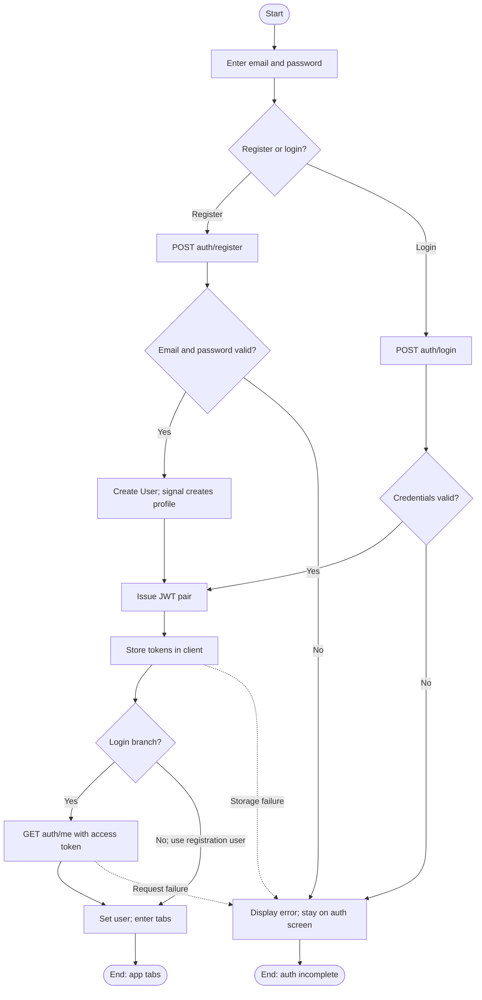
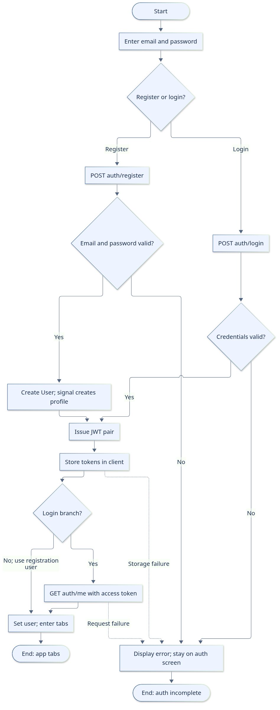
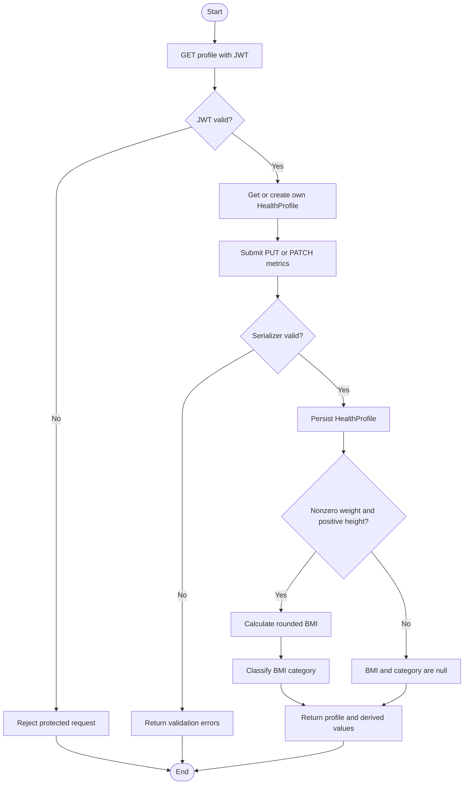
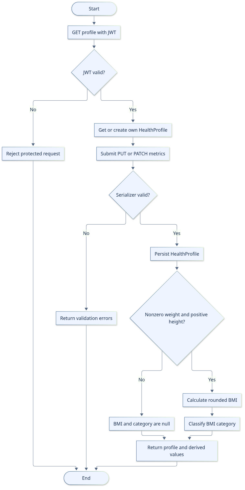
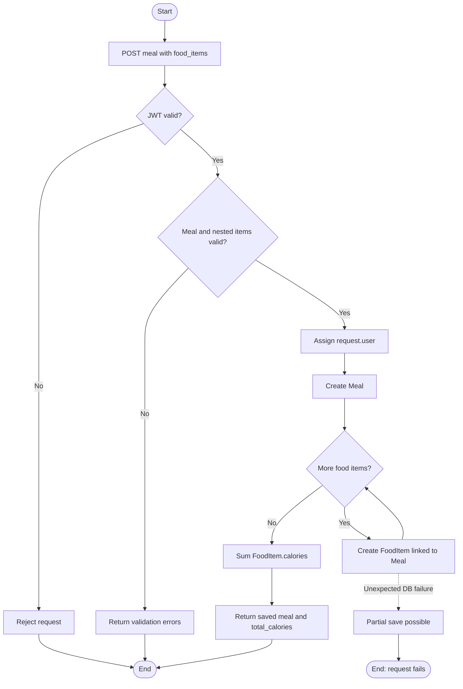
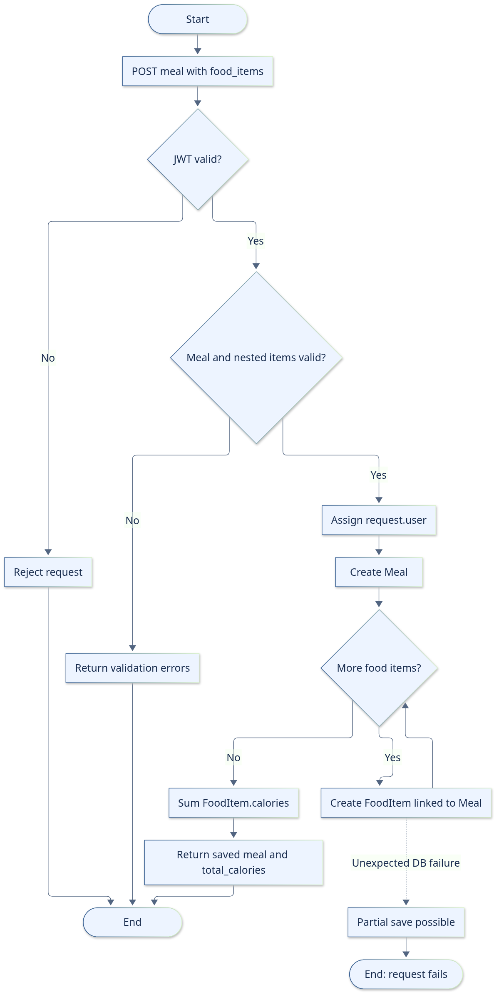
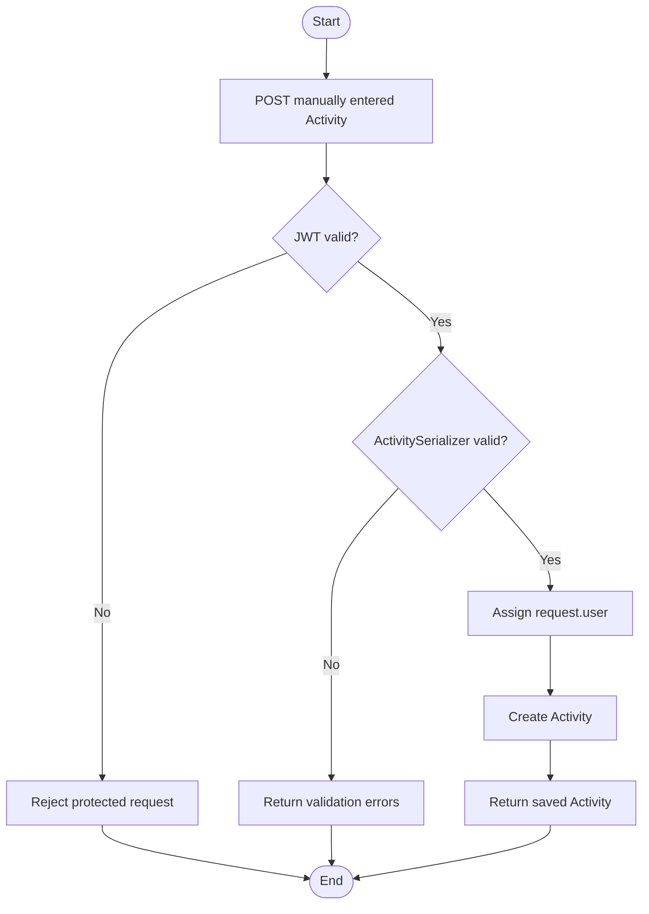
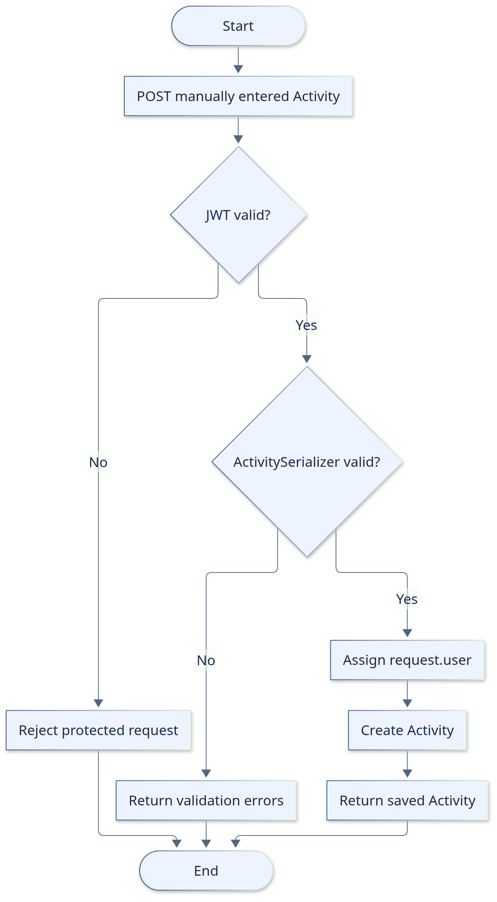
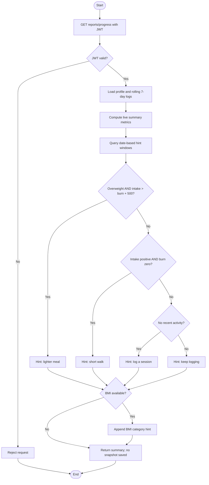
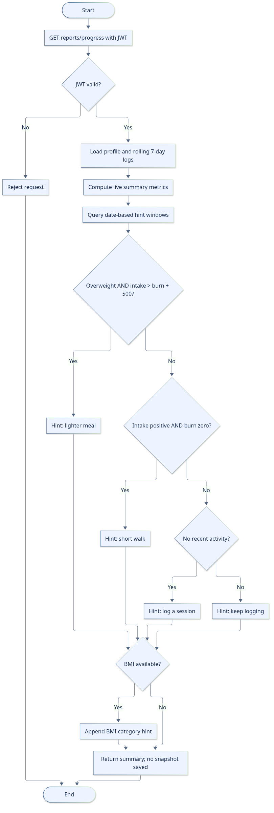

# Activity diagrams

Five flows for UC1–UC5. Mermaid + PNG fallback. Auth is on mobile; UC2–UC5 are API-level for now.

## AD1 / UC1 — Register or log in

**Status:** API and mobile authentication implemented.

## Reading notes

Includes real login/registration differences. There is no onboarding/profile gate. A stored refresh token is not automatically exchanged. Network failures on initial auth calls also display an error; the dashed edges highlight failures after tokens may have been issued.

## Sources

- `apps/api/accounts/models.py`
- `apps/api/accounts/serializers.py`
- `apps/api/accounts/views.py`
- `apps/api/accounts/signals.py`
- `apps/api/accounts/apps.py`
- `apps/api/accounts/urls.py`
- `apps/mobile/app/(auth)/login.tsx`
- `apps/mobile/app/(auth)/register.tsx`
- `apps/mobile/lib/auth.tsx`
- `apps/mobile/app/index.tsx`

[Editable SVG](images/activity-01-auth.svg)

## AD2 / UC2 — Manage health profile

**Status:** Profile and Goal APIs implemented; mobile Profile is a placeholder.

## Reading notes

Goals are a separate API (not part of this profile save). `is_complete` checks age/height/weight/gender.

## Sources

- `apps/api/profiles/models.py`
- `apps/api/profiles/serializers.py`
- `apps/api/profiles/views.py`
- `apps/api/profiles/urls.py`
- `apps/mobile/app/(tabs)/profile.tsx`

[Editable SVG](images/activity-02-profile.svg)

## AD3 / UC3 — Log a meal

**Status:** Nested meal API implemented; mobile Meals is a placeholder.

## Reading notes

API-level flow; the mobile meal form is planned. food_items is required on create but may be empty. Validation completes before creation, yet DB errors after creation can still leave partial data. Portion is metadata, not a multiplier.

## Sources

- `apps/api/nutrition/models.py`
- `apps/api/nutrition/serializers.py`
- `apps/api/nutrition/views.py`
- `apps/api/nutrition/urls.py`
- `apps/mobile/app/(tabs)/meals.tsx`

[Editable SVG](images/activity-03-meal.svg)

## AD4 / UC4 — Log physical activity

**Status:** Activity API implemented; mobile Activities is a placeholder.

## Reading notes

API-level flow; mobile activity form is planned. Manual calories_burned; there is no automatic estimate. PositiveIntegerField allows 0 duration; FloatField has no declared positivity constraint.

## Sources

- `apps/api/fitness/models.py`
- `apps/api/fitness/serializers.py`
- `apps/api/fitness/views.py`
- `apps/api/fitness/urls.py`
- `apps/mobile/app/(tabs)/activities.tsx`

[Editable SVG](images/activity-04-activity.svg)

## AD5 / UC5 — View progress and suggestions

**Status:** Live summary and hint APIs implemented; mobile Progress/charts are placeholders.

## Reading notes

API-level flow; mobile charts are planned. Summary window uses timestamps while hint windows use dates; their boundary records can differ. Both windows have only a lower bound, so future records may count. No historical weight/BMI series or saved ProgressReport is produced.

## Sources

- `apps/api/insights/models.py`
- `apps/api/insights/services.py`
- `apps/api/insights/views.py`
- `apps/api/insights/urls.py`
- `apps/api/profiles/models.py`
- `apps/api/nutrition/models.py`
- `apps/api/fitness/models.py`
- `apps/mobile/app/(tabs)/progress.tsx`

[Editable SVG](images/activity-05-progress.svg)

[Use-case specifications](02-use-cases.md) · [SRS](01-SRS.md)
