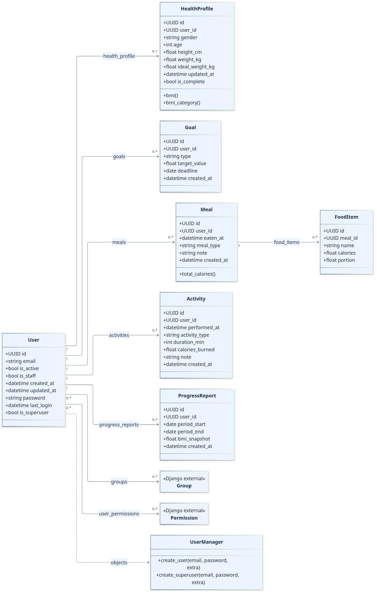
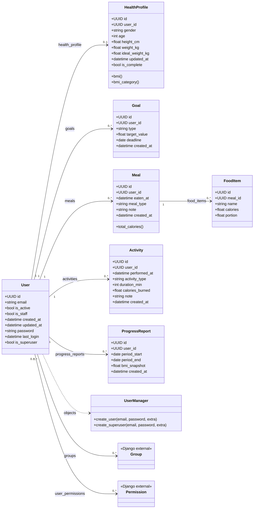

# Class diagram

Seven project-defined persisted classes and the non-persistent UserManager. Group and Permission are Django classes, not custom features. UUID fields shown as user_id/meal_id are the database columns for Python relationships user/meal. Abstract Django base classes do not create extra project tables.

[Editable SVG](images/class-diagram.svg)

## User

**Source:** `apps/api/accounts/models.py`  
**Migration:** `apps/api/accounts/migrations/0001_initial.py`  
**Inheritance:** `AbstractBaseUser + PermissionsMixin`

### Attributes

| Attribute / DB column | Type | Constraints / behavior |
|---|---|---|
| `id` | UUID | PK; uuid4 default; not editable |
| `email` | Email / varchar(254) | Required; unique; USERNAME_FIELD |
| `is_active` | Boolean | Default true |
| `is_staff` | Boolean | Default false |
| `created_at` | DateTime | Required; auto_now_add |
| `updated_at` | DateTime | Required; auto_now |
| `password` | varchar(128) | Inherited; encoded password hash, not password_hash |
| `last_login` | DateTime | Inherited; nullable; blank allowed |
| `is_superuser` | Boolean | Inherited; default false |
| `groups` | ManyToMany(Group) | Inherited; optional; framework join table |
| `user_permissions` | ManyToMany(Permission) | Inherited; optional; framework join table |

### Project-defined methods / properties

| Member | Returns / type | Behavior |
|---|---|---|
| `__str__()` | str | Returns email; no personal value reproduced. |
| `objects` | UserManager | Custom manager, not a persisted field. |

### Notes

AbstractBaseUser and PermissionsMixin are abstract Django parents, not extra application tables. No username, first_name, last_name or date_joined field is declared. Inherited authentication/permission methods are framework behavior, not project-defined methods.

Foreign-key columns are named `user_id` / `meal_id` in the DB; the Python attributes are `user` / `meal`. All undeclared nullability defaults to NOT NULL; “blank” is validation behavior, not SQL NULL. UUID defaults are Python-side. Choices are enforced by serializer/model validation, not an explicit DB CHECK in these migrations.

## UserManager — non-persistent helper

Source: `apps/api/accounts/models.py`. Extends Django `BaseUserManager`. Not a model/table and excluded from the count of seven persisted domain models.

| Method | Parameters | Result / behavior |
|---|---|---|
| `create_user` | email, password=None, **extra | Requires email; normalizes it; hashes password; saves User using manager DB; returns user. |
| `create_superuser` | email, password=None, **extra | Defaults is_staff and is_superuser to true, then calls create_user. Explicit false overrides are not rejected. |

`User.objects` uses this manager. `HealthProfile` creation is a separate post_save signal, not a manager method. Nested GoalType, MealType and ActivityType are TextChoices enums documented in the corresponding model tables, not additional DB models.

## HealthProfile

**Source:** `apps/api/profiles/models.py`  
**Migration:** `apps/api/profiles/migrations/0001_initial.py`  
**Inheritance:** `models.Model`

### Attributes

| Attribute / DB column | Type | Constraints / behavior |
|---|---|---|
| `id` | UUID | PK; uuid4 default; not editable |
| `user_id` | UUID | Unique FK → User.id; OneToOne; required; CASCADE |
| `gender` | varchar(32) | Blank allowed; default empty string; no enum |
| `age` | PositiveInteger | Nullable; blank allowed; zero permitted |
| `height_cm` | Float | Nullable; blank allowed; no positive constraint |
| `weight_kg` | Float | Nullable; blank allowed; no positive constraint |
| `ideal_weight_kg` | Float | Nullable; blank allowed; no positive constraint |
| `updated_at` | DateTime | Required; auto_now |

### Project-defined methods / properties

| Member | Returns / type | Behavior |
|---|---|---|
| `bmi()` | float or None | If nonzero height/weight and height > 0, round(weight / (height/100)^2, 1); else None. |
| `bmi_category()` | str or None | Uses rounded BMI: <18.5 underweight; <25 normal; <30 overweight; else obese. |
| `is_complete [property]` | bool | Truthiness of age, height_cm, weight_kg and gender; not a stored column. |
| `__str__()` | str | Profile label containing user ID. |

### Notes

No history table is created for changing height/weight. BMI and category are serializer-derived fields, not persisted attributes. A post-save User signal normally creates one empty profile; get_object also repairs absence.

Foreign-key columns are named `user_id` / `meal_id` in the DB; the Python attributes are `user` / `meal`. All undeclared nullability defaults to NOT NULL; “blank” is validation behavior, not SQL NULL. UUID defaults are Python-side. Choices are enforced by serializer/model validation, not an explicit DB CHECK in these migrations.

## Goal

**Source:** `apps/api/profiles/models.py`  
**Migration:** `apps/api/profiles/migrations/0001_initial.py`  
**Inheritance:** `models.Model`

### Attributes

| Attribute / DB column | Type | Constraints / behavior |
|---|---|---|
| `id` | UUID | PK; uuid4 default; not editable |
| `user_id` | UUID | FK → User.id; required; CASCADE |
| `type` | varchar(32) | GoalType choices; required |
| `target_value` | Float | Nullable; blank allowed |
| `deadline` | Date | Nullable; blank allowed; no future-date constraint |
| `created_at` | DateTime | Required; auto_now_add |

### Project-defined methods / properties

| Member | Returns / type | Behavior |
|---|---|---|
| `__str__()` | str | Goal type and user ID. |

### Notes

GoalType = lose_weight, gain_weight, maintain, build_muscle. No active/completed state or unique-current-goal constraint. Goal comparison is planned; progress_summary does not query Goal.

Foreign-key columns are named `user_id` / `meal_id` in the DB; the Python attributes are `user` / `meal`. All undeclared nullability defaults to NOT NULL; “blank” is validation behavior, not SQL NULL. UUID defaults are Python-side. Choices are enforced by serializer/model validation, not an explicit DB CHECK in these migrations.

## Meal

**Source:** `apps/api/nutrition/models.py`  
**Migration:** `apps/api/nutrition/migrations/0001_initial.py`  
**Inheritance:** `models.Model`

### Attributes

| Attribute / DB column | Type | Constraints / behavior |
|---|---|---|
| `id` | UUID | PK; uuid4 default; not editable |
| `user_id` | UUID | FK → User.id; required; CASCADE |
| `eaten_at` | DateTime | Required; no future-date constraint |
| `meal_type` | varchar(16) | MealType choices; required |
| `note` | varchar(255) | Blank allowed; default empty string |
| `created_at` | DateTime | Required; auto_now_add |

### Project-defined methods / properties

| Member | Returns / type | Behavior |
|---|---|---|
| `total_calories()` | number | sum(item.calories for item in food_items.all()); zero if empty. |
| `__str__()` | str | Meal type and eaten_at. |

### Notes

MealType = breakfast, lunch, dinner, snack. total_calories is computed, not stored. portion is NOT used by this method. No user/day/type uniqueness constraint.

Foreign-key columns are named `user_id` / `meal_id` in the DB; the Python attributes are `user` / `meal`. All undeclared nullability defaults to NOT NULL; “blank” is validation behavior, not SQL NULL. UUID defaults are Python-side. Choices are enforced by serializer/model validation, not an explicit DB CHECK in these migrations.

## FoodItem

**Source:** `apps/api/nutrition/models.py`  
**Migration:** `apps/api/nutrition/migrations/0001_initial.py`  
**Inheritance:** `models.Model`

### Attributes

| Attribute / DB column | Type | Constraints / behavior |
|---|---|---|
| `id` | UUID | PK; uuid4 default; not editable |
| `meal_id` | UUID | FK → Meal.id; required; CASCADE |
| `name` | varchar(120) | Required |
| `calories` | Float | Required; no positive constraint |
| `portion` | Float | Default 1.0; no positive constraint |

### Project-defined methods / properties

| Member | Returns / type | Behavior |
|---|---|---|
| `__str__()` | str | Returns food name. |

### Notes

A food item is a meal-specific entry, not a reusable global Food catalogue. No separate owner, nutrients or timestamps are declared.

Foreign-key columns are named `user_id` / `meal_id` in the DB; the Python attributes are `user` / `meal`. All undeclared nullability defaults to NOT NULL; “blank” is validation behavior, not SQL NULL. UUID defaults are Python-side. Choices are enforced by serializer/model validation, not an explicit DB CHECK in these migrations.

## Activity

**Source:** `apps/api/fitness/models.py`  
**Migration:** `apps/api/fitness/migrations/0001_initial.py`  
**Inheritance:** `models.Model`

### Attributes

| Attribute / DB column | Type | Constraints / behavior |
|---|---|---|
| `id` | UUID | PK; uuid4 default; not editable |
| `user_id` | UUID | FK → User.id; required; CASCADE |
| `performed_at` | DateTime | Required; no future-date constraint |
| `activity_type` | varchar(16) | ActivityType choices; required |
| `duration_min` | PositiveInteger | Required; zero allowed |
| `calories_burned` | Float | Required; no positive constraint |
| `note` | varchar(255) | Blank allowed; default empty string |
| `created_at` | DateTime | Required; auto_now_add |

### Project-defined methods / properties

| Member | Returns / type | Behavior |
|---|---|---|
| `__str__()` | str | Activity type and duration. |

### Notes

ActivityType = walk, run, gym, sport, other. Manual entry: no estimator, wearable model or exercise catalogue.

Foreign-key columns are named `user_id` / `meal_id` in the DB; the Python attributes are `user` / `meal`. All undeclared nullability defaults to NOT NULL; “blank” is validation behavior, not SQL NULL. UUID defaults are Python-side. Choices are enforced by serializer/model validation, not an explicit DB CHECK in these migrations.

## ProgressReport

**Source:** `apps/api/insights/models.py`  
**Migration:** `apps/api/insights/migrations/0001_initial.py`  
**Inheritance:** `models.Model`

### Attributes

| Attribute / DB column | Type | Constraints / behavior |
|---|---|---|
| `id` | UUID | PK; uuid4 default; not editable |
| `user_id` | UUID | FK → User.id; required; CASCADE |
| `period_start` | Date | Required |
| `period_end` | Date | Required; no start/end ordering constraint |
| `bmi_snapshot` | Float | Nullable; blank allowed |
| `created_at` | DateTime | Required; auto_now_add |

### Project-defined methods / properties

| Member | Returns / type | Behavior |
|---|---|---|
| `__str__()` | str | Report date range. |

### Notes

Optional persisted snapshot model exists and is registered in Admin. The live progress endpoint neither reads nor writes it. There is NO calorieBalance()/calorie_balance() model method, calories_in column, or stored suggestions field.

Foreign-key columns are named `user_id` / `meal_id` in the DB; the Python attributes are `user` / `meal`. All undeclared nullability defaults to NOT NULL; “blank” is validation behavior, not SQL NULL. UUID defaults are Python-side. Choices are enforced by serializer/model validation, not an explicit DB CHECK in these migrations.

## Relationships and deletion

| Parent | Child | Multiplicity (parent → child) | Child column | Reverse accessor | Delete parent |
|---|---|---|---|---|---|
| User | HealthProfile | 1 → 0..1 at schema level | user_id; unique, NOT NULL | health_profile | CASCADE |
| User | Goal | 1 → 0..* | user_id; NOT NULL | goals | CASCADE |
| User | Meal | 1 → 0..* | user_id; NOT NULL | meals | CASCADE |
| Meal | FoodItem | 1 → 0..* | meal_id; NOT NULL | food_items | CASCADE |
| User | Activity | 1 → 0..* | user_id; NOT NULL | activities | CASCADE |
| User | ProgressReport | 1 → 0..* | user_id; NOT NULL | progress_reports | CASCADE |
| User | Django Group | 0..* ↔ 0..* | inherited groups through table | framework user_set | Framework-managed |
| User | Django Permission | 0..* ↔ 0..* | inherited user_permissions through table | framework user_set | Framework-managed |

Each child in the first six rows has exactly one parent. The application normally ensures a profile exists through a registration signal; a unique FK alone cannot force every User to have a profile. Thus 0..1 is more precise for the physical schema than the sketches’ unconditional 1:1.

Framework tables (Group, Permission, ContentType, Session, Admin LogEntry, M2M joins) come from Django itself — details in `docs/05-database-tables.md`.

Evidence: all five `apps/api/*/models.py` files and matching `migrations/0001_initial.py`. Relationships are owner-based, not coach assignments. No Goal→HealthProfile FK exists.

[Physical tables and ER diagrams](05-database-tables.md) · [SRS](01-SRS.md)
