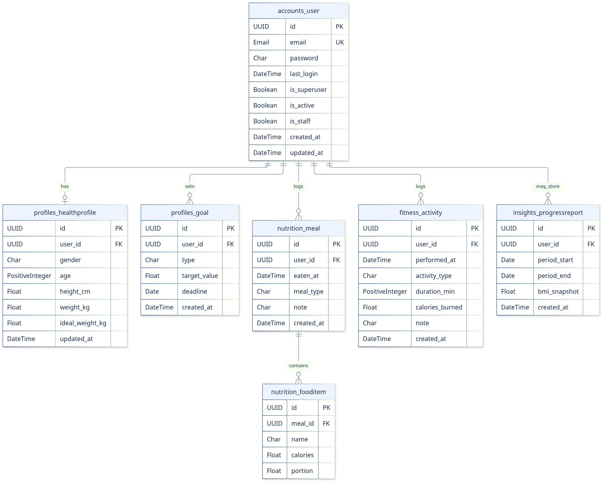
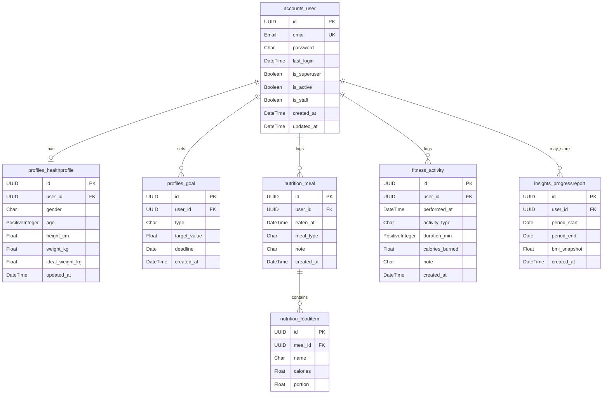
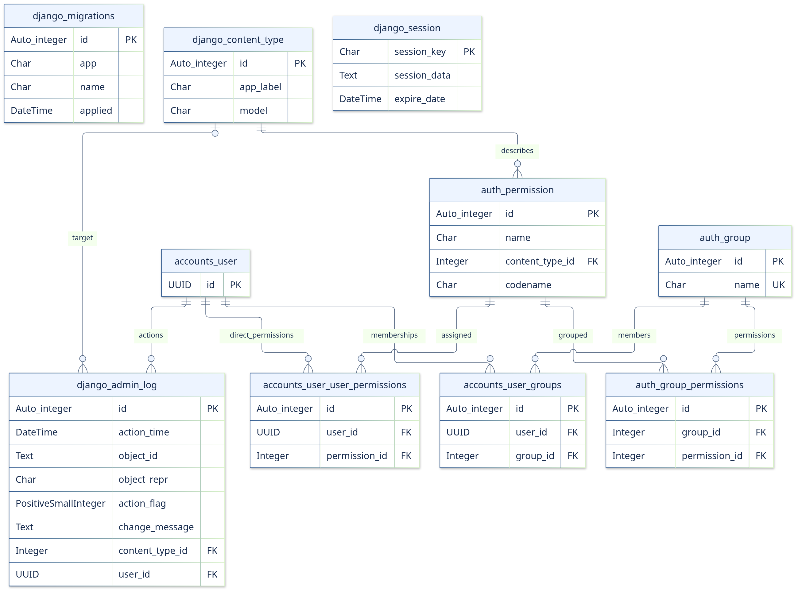
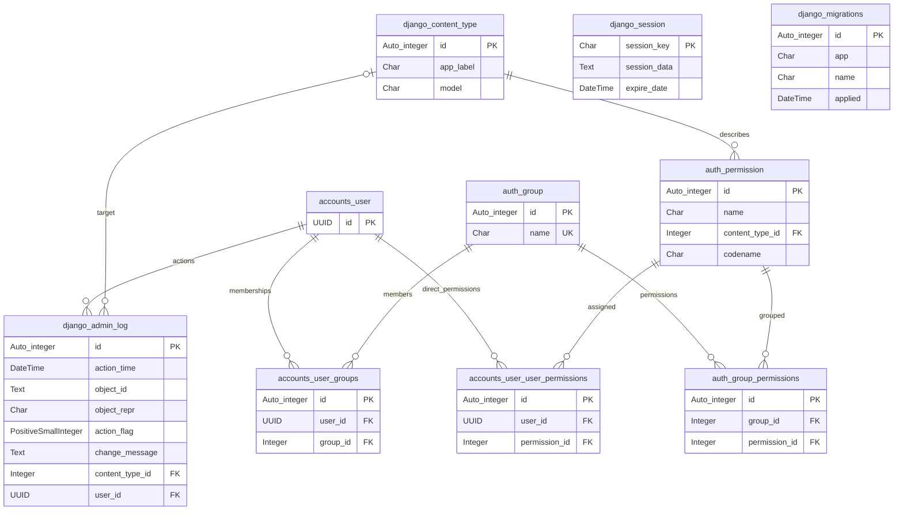

# Database tables

## 1. What this schema represents

The seven project models and their five `0001_initial.py` migrations define the application schema. Default Django naming creates the tables below; none of these models overrides `db_table`. Two inherited many-to-many relations create two additional tables. Enabled Django auth/contenttypes/admin/sessions add their standard tables, and the migration recorder adds one infrastructure table: **16 expected tables after a normal fresh migration**. The custom User swaps out Django's built-in User, so **auth_user is not expected**. UserManager and TextChoices enums are not tables.

Built from models + `0001_initial` migrations (Django 5.2.x), not a live DB dump. Framework table names follow Django’s defaults.

### Types, defaults and indexes

- Types below show Django type → **SQLite declared type**, the default configured database. PostgreSQL uses native uuid, boolean, double precision, timestamp with time zone, date and varchar types; automatic IDs use identity/sequence-backed integers. PositiveInteger/PositiveSmallInteger map to integer/smallint with non-negative checks (not a strictly-positive rule).
- UUID PKs are generated by Python `uuid.uuid4`, not SQL DEFAULT expressions. auto_now/auto_now_add and declared defaults are ORM behavior, not permanent SQL DEFAULT clauses. “—” means no declared model default; nullable fields normally initialize to None. Required text fields can initialize to an empty string at ORM level even when API serializers require nonblank input.
- **Null** describes SQL nullability. `blank=True` controls validation; it does not imply NULL. **Unique** is per-column uniqueness only; composite unique constraints are stated separately.
- **PK** denotes primary key/its supporting index; SQLite integer auto IDs use the rowid primary key. **FK index** is Django's default FK index. Unique foreign keys have a supporting unique index rather than needing a duplicate non-unique one.
- No custom Meta indexes, unique-together rules or explicit business CHECK constraints are declared for the seven application tables. Besides generated PK/unique/FK indexes, dates used for filtering are not explicitly indexed.
- All project ownership/meal relationships declare Django ORM **CASCADE**. This is Django deletion behavior, not a claim that emitted SQL uses ON DELETE CASCADE; Django's collector performs the cascade. SQLite introspection can show NO ACTION at SQL level.
- Choices constrain validated values; no explicit choice CHECK is present in these migrations. Sensitive column names are documented, but no stored credentials, tokens, personal records or secret values are included.

## 2. Application ER diagram

[Editable SVG](images/database-domain.svg)

The profile association is zero-or-one at schema level. Each child has exactly one parent; a parent can have zero children. Report storage is optional and not invoked by live reporting.

## 3. Application tables

### `accounts_user`

Custom authentication model. password, last_login and is_superuser are inherited. There is no username or date_joined column. groups and user_permissions use separate join tables below.

| Column | Django → SQLite type | PK / FK | Null | Unique | Default / generated value | Index |
|---|---|---|---|---|---|---|
| id | UUID → char(32) | PK | No | Yes | uuid.uuid4 (ORM) | PK |
| email | Email(254) → varchar(254) | — | No | Yes | — | Unique |
| password | Char(128) → varchar(128) | — | No | No | Encoded password via set_password; implicit empty string if not set | — |
| last_login | DateTime → datetime | — | Yes | No | — | — |
| is_superuser | Boolean → bool | — | No | No | False (ORM) | — |
| is_active | Boolean → bool | — | No | No | True (ORM) | — |
| is_staff | Boolean → bool | — | No | No | False (ORM) | — |
| created_at | DateTime → datetime | — | No | No | auto_now_add (ORM) | — |
| updated_at | DateTime → datetime | — | No | No | auto_now (ORM) | — |

### `profiles_healthprofile`

user_id is a one-to-one link. SQL permits a user without a profile; the registration signal normally creates one. BMI, category and is_complete are computed, not stored.

| Column | Django → SQLite type | PK / FK | Null | Unique | Default / generated value | Index |
|---|---|---|---|---|---|---|
| id | UUID → char(32) | PK | No | Yes | uuid.uuid4 (ORM) | PK |
| user_id | UUID → char(32) | FK → accounts_user.id | No | Yes | — | Unique FK |
| gender | Char(32) → varchar(32) | — | No | No | Empty string (ORM) | — |
| age | PositiveInteger → integer unsigned | — | Yes | No | — | — |
| height_cm | Float → real | — | Yes | No | — | — |
| weight_kg | Float → real | — | Yes | No | — | — |
| ideal_weight_kg | Float → real | — | Yes | No | — | — |
| updated_at | DateTime → datetime | — | No | No | auto_now (ORM) | — |

### `profiles_goal`

type choices: lose_weight, gain_weight, maintain, build_muscle. No explicit choice CHECK or deadline index in the migration.

| Column | Django → SQLite type | PK / FK | Null | Unique | Default / generated value | Index |
|---|---|---|---|---|---|---|
| id | UUID → char(32) | PK | No | Yes | uuid.uuid4 (ORM) | PK |
| user_id | UUID → char(32) | FK → accounts_user.id | No | No | — | FK index |
| type | Char(32) → varchar(32) | — | No | No | No explicit; implicit empty string at model initialization | — |
| target_value | Float → real | — | Yes | No | — | — |
| deadline | Date → date | — | Yes | No | — | — |
| created_at | DateTime → datetime | — | No | No | auto_now_add (ORM) | — |

### `nutrition_meal`

meal_type choices: breakfast, lunch, dinner, snack. total_calories is computed, not a DB column. eaten_at has no explicit index.

| Column | Django → SQLite type | PK / FK | Null | Unique | Default / generated value | Index |
|---|---|---|---|---|---|---|
| id | UUID → char(32) | PK | No | Yes | uuid.uuid4 (ORM) | PK |
| user_id | UUID → char(32) | FK → accounts_user.id | No | No | — | FK index |
| eaten_at | DateTime → datetime | — | No | No | — | — |
| meal_type | Char(16) → varchar(16) | — | No | No | No explicit; implicit empty string at model initialization | — |
| note | Char(255) → varchar(255) | — | No | No | Empty string (ORM) | — |
| created_at | DateTime → datetime | — | No | No | auto_now_add (ORM) | — |

### `nutrition_fooditem`

Each row belongs to one meal, not to a reusable food catalogue. No explicit positive checks for calories/portion.

| Column | Django → SQLite type | PK / FK | Null | Unique | Default / generated value | Index |
|---|---|---|---|---|---|---|
| id | UUID → char(32) | PK | No | Yes | uuid.uuid4 (ORM) | PK |
| meal_id | UUID → char(32) | FK → nutrition_meal.id | No | No | — | FK index |
| name | Char(120) → varchar(120) | — | No | No | No explicit; implicit empty string at model initialization | — |
| calories | Float → real | — | No | No | — | — |
| portion | Float → real | — | No | No | 1.0 (ORM) | — |

### `fitness_activity`

activity_type choices: walk, run, gym, sport, other. Duration has a non-negative backend constraint; zero is allowed. No burn estimator or performed_at index is declared.

| Column | Django → SQLite type | PK / FK | Null | Unique | Default / generated value | Index |
|---|---|---|---|---|---|---|
| id | UUID → char(32) | PK | No | Yes | uuid.uuid4 (ORM) | PK |
| user_id | UUID → char(32) | FK → accounts_user.id | No | No | — | FK index |
| performed_at | DateTime → datetime | — | No | No | — | — |
| activity_type | Char(16) → varchar(16) | — | No | No | No explicit; implicit empty string at model initialization | — |
| duration_min | PositiveInteger → integer unsigned | — | No | No | — | — |
| calories_burned | Float → real | — | No | No | — | — |
| note | Char(255) → varchar(255) | — | No | No | Empty string (ORM) | — |
| created_at | DateTime → datetime | — | No | No | auto_now_add (ORM) | — |

### `insights_progressreport`

Optional saved snapshot model. The live reports endpoint does not write rows here. No explicit period_start ≤ period_end check or period index is declared.

| Column | Django → SQLite type | PK / FK | Null | Unique | Default / generated value | Index |
|---|---|---|---|---|---|---|
| id | UUID → char(32) | PK | No | Yes | uuid.uuid4 (ORM) | PK |
| user_id | UUID → char(32) | FK → accounts_user.id | No | No | — | FK index |
| period_start | Date → date | — | No | No | — | — |
| period_end | Date → date | — | No | No | — | — |
| bmi_snapshot | Float → real | — | Yes | No | — | — |
| created_at | DateTime → datetime | — | No | No | auto_now_add (ORM) | — |

## 4. Authentication, Admin and infrastructure tables

These tables are framework/inherited plumbing, separated from the seven domain classes for classroom clarity.

### `accounts_user_groups`

Auto-created by inherited User.groups. Unique pair (user_id, group_id); each FK also indexed. Surrogate ID uses the accounts app/default auto field.

| Column | Django → SQLite type | PK / FK | Null | Unique | Default / generated value | Index |
|---|---|---|---|---|---|---|
| id | Auto integer → INTEGER | PK | No | Yes | Auto-generated | PK / rowid |
| user_id | UUID → char(32) | FK → accounts_user.id | No | No | — | FK index |
| group_id | Integer → INTEGER | FK → auth_group.id | No | No | — | FK index |

### `accounts_user_user_permissions`

Auto-created by inherited User.user_permissions. Unique pair (user_id, permission_id); each FK also indexed.

| Column | Django → SQLite type | PK / FK | Null | Unique | Default / generated value | Index |
|---|---|---|---|---|---|---|
| id | Auto integer → INTEGER | PK | No | Yes | Auto-generated | PK / rowid |
| user_id | UUID → char(32) | FK → accounts_user.id | No | No | — | FK index |
| permission_id | Integer → INTEGER | FK → auth_permission.id | No | No | — | FK index |

### `auth_group`

Django framework table, not a custom project class.

| Column | Django → SQLite type | PK / FK | Null | Unique | Default / generated value | Index |
|---|---|---|---|---|---|---|
| id | Auto integer → INTEGER | PK | No | Yes | Auto-generated | PK / rowid |
| name | Char(150) → varchar(150) | — | No | Yes | Implicit empty string at model initialization | Unique |

### `auth_permission`

Unique pair (content_type_id, codename). Django generates add/change/delete/view permissions after migrations.

| Column | Django → SQLite type | PK / FK | Null | Unique | Default / generated value | Index |
|---|---|---|---|---|---|---|
| id | Auto integer → INTEGER | PK | No | Yes | Auto-generated | PK / rowid |
| name | Char(255) → varchar(255) | — | No | No | Implicit empty string at model initialization | — |
| content_type_id | Integer → INTEGER | FK → django_content_type.id | No | No | — | FK index |
| codename | Char(100) → varchar(100) | — | No | No | Implicit empty string at model initialization | — |

### `auth_group_permissions`

Auto-created Group.permissions join table. Unique pair (group_id, permission_id).

| Column | Django → SQLite type | PK / FK | Null | Unique | Default / generated value | Index |
|---|---|---|---|---|---|---|
| id | Auto integer → INTEGER | PK | No | Yes | Auto-generated | PK / rowid |
| group_id | Integer → INTEGER | FK → auth_group.id | No | No | — | FK index |
| permission_id | Integer → INTEGER | FK → auth_permission.id | No | No | — | FK index |

### `django_content_type`

Unique pair (app_label, model). Framework model registry; not an application feature.

| Column | Django → SQLite type | PK / FK | Null | Unique | Default / generated value | Index |
|---|---|---|---|---|---|---|
| id | Auto integer → INTEGER | PK | No | Yes | Auto-generated | PK / rowid |
| app_label | Char(100) → varchar(100) | — | No | No | Implicit empty string at model initialization | — |
| model | Char(100) → varchar(100) | — | No | No | Implicit empty string at model initialization | — |

### `django_admin_log`

Django Admin audit log. content_type deletion uses ORM SET_NULL; user deletion uses ORM CASCADE. No health-record values are reproduced in this package.

| Column | Django → SQLite type | PK / FK | Null | Unique | Default / generated value | Index |
|---|---|---|---|---|---|---|
| id | Auto integer → INTEGER | PK | No | Yes | Auto-generated | PK / rowid |
| action_time | DateTime → datetime | — | No | No | timezone.now (ORM) | — |
| object_id | Text → TEXT | — | Yes | No | — | — |
| object_repr | Char(200) → varchar(200) | — | No | No | Implicit empty string at model initialization | — |
| action_flag | PositiveSmallInteger → smallint unsigned | — | No | No | — | — |
| change_message | Text → TEXT | — | No | No | Implicit empty string at model initialization | — |
| content_type_id | Integer → INTEGER | FK → django_content_type.id | Yes | No | — | FK index |
| user_id | UUID → char(32) | FK → accounts_user.id | No | No | — | FK index |

### `django_session`

Default Django database-backed sessions, used by Admin. These are not JWT token rows.

| Column | Django → SQLite type | PK / FK | Null | Unique | Default / generated value | Index |
|---|---|---|---|---|---|---|
| session_key | Char(40) → varchar(40) | PK | No | Yes | Generated by session backend | PK |
| session_data | Text → TEXT | — | No | No | Session backend serialization | — |
| expire_date | DateTime → datetime | — | No | No | — | Explicit index |

### `django_migrations`

Django migration recorder; lists applied migrations. No declared unique pair in the recorder model.

| Column | Django → SQLite type | PK / FK | Null | Unique | Default / generated value | Index |
|---|---|---|---|---|---|---|
| id | Auto integer → INTEGER | PK | No | Yes | Auto-generated | PK / rowid |
| app | Char(255) → varchar(255) | — | No | No | — | — |
| name | Char(255) → varchar(255) | — | No | No | — | — |
| applied | DateTime → datetime | — | No | No | timezone.now (migration recorder) | — |

## 5. Framework ER diagram

[Editable SVG](images/database-framework.svg)

The two independent entities in this diagram, django_session and django_migrations, have no declared foreign-key relationship to the project User. The User entity is repeated only as an anchor for authorization/Admin links; it is the same accounts_user table as in the application ER diagram.

## 6. Source map and explain-it checklist

| Table group | Primary source |
|---|---|
| accounts_user and inherited join tables | `apps/api/accounts/models.py`, `apps/api/accounts/migrations/0001_initial.py`; AbstractBaseUser / PermissionsMixin |
| profiles_healthprofile, profiles_goal | `apps/api/profiles/models.py`, `apps/api/profiles/migrations/0001_initial.py` |
| nutrition_meal, nutrition_fooditem | `apps/api/nutrition/models.py`, `apps/api/nutrition/migrations/0001_initial.py` |
| fitness_activity | `apps/api/fitness/models.py`, `apps/api/fitness/migrations/0001_initial.py` |
| insights_progressreport | `apps/api/insights/models.py`, `apps/api/insights/migrations/0001_initial.py` |
| Django standard tables | Enabled apps, AUTH_USER_MODEL and DEFAULT_AUTO_FIELD in `apps/api/config/settings.py`; Django framework migrations |

To explain the schema: start at accounts_user, follow nutrition_meal → nutrition_fooditem, explain one-to-one versus one-to-many, then distinguish computed methods from stored columns. Finish with the difference between seven domain models, nine domain/auth-link tables, and sixteen total expected migrated tables.

[Class diagram](04-class-diagram.md) · [SRS](01-SRS.md)
