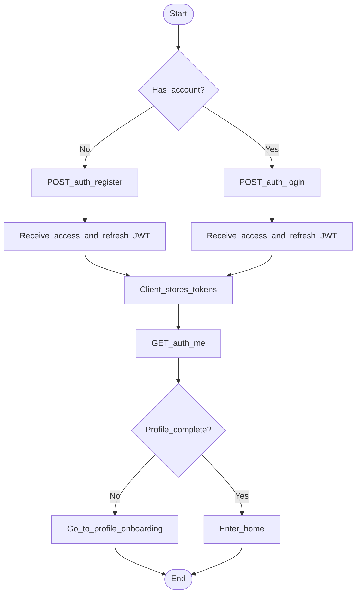

# Activity 1 — Auth (register / login + JWT)

Focused on authentication only. Profile completion is [activity-profile.md](activity-profile.md).

## Notes

- Auth: email + password → SimpleJWT access/refresh.
- Failed login: stay on auth screen with error (not shown for brevity).
