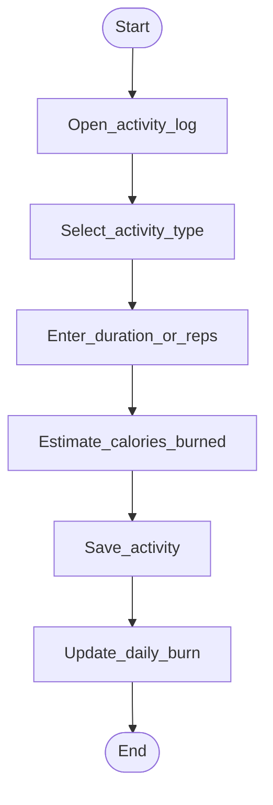

# Activity — Log fitness

**Status:** stub — refine after TFIT research.

## Open questions (fill from RE)

- Manual entry vs sensor/steps (semester scope: manual first)
- Activity catalog vs custom
