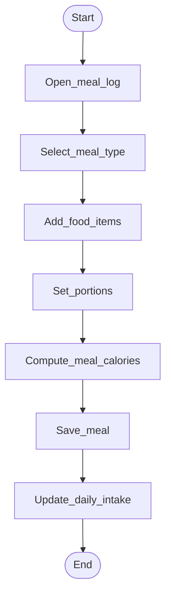

# Activity — Log meal

**Status:** stub — refine after TFIT research.

## Open questions (fill from RE)

- Meal types used in TFIT (breakfast/lunch/…)
- Food catalog vs free-text
- Whether macros are tracked beyond calories
