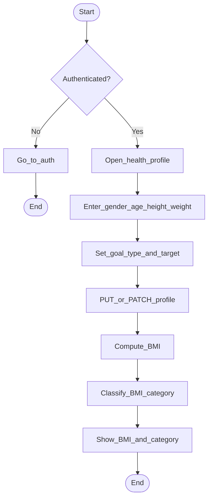

# Activity 2 — Manage health profile + BMI

## BMI categories (adult WHO-style)

| Category | BMI |
|----------|-----|
| Underweight | &lt; 18.5 |
| Normal | 18.5 – 24.9 |
| Overweight | 25 – 29.9 |
| Obese | ≥ 30 |

`BMI = weight_kg / (height_m ^ 2)`.
