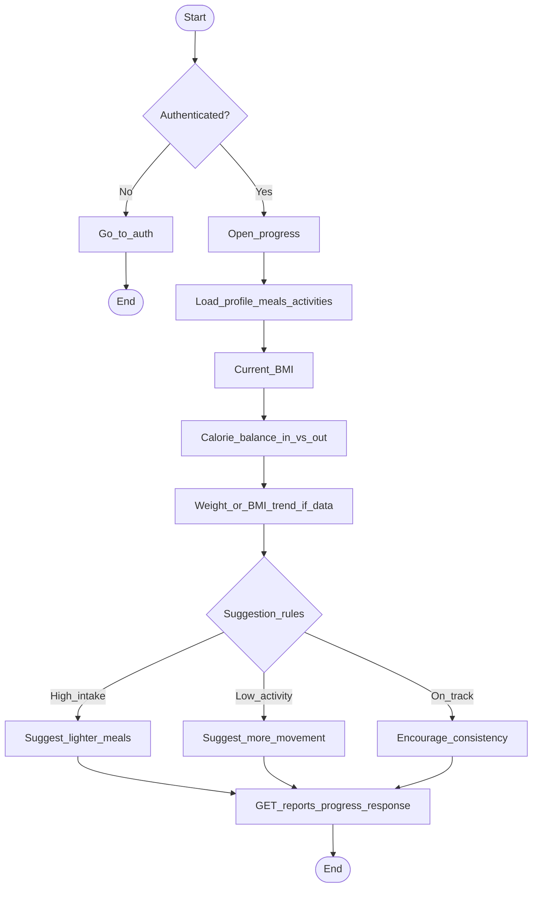

# Activity 5 — Progress report + suggestions

## Suggestion rules (MVP, rule-based)

- If today’s intake ≫ recent burn → nutrition hint.
- If no activity in N days → fitness hint.
- Else → stay-on-protocol message (Relapsa tone).
