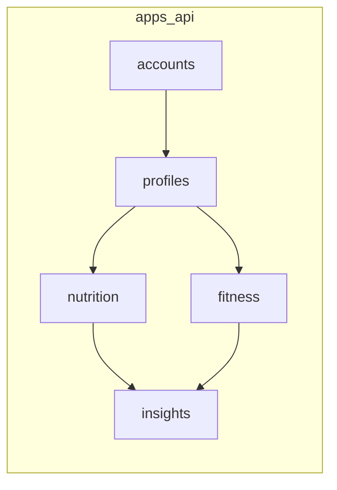

# Backend modules (Django)

| App | Responsibility | Models |
|-----|----------------|--------|
| `accounts` | Register, login, JWT, `/auth/me` | User |
| `profiles` | Health profile, goals, BMI | HealthProfile, Goal |
| `nutrition` | Meals & food items | Meal, FoodItem |
| `fitness` | Activity logs | Activity |
| `insights` | Progress report + suggestions | ProgressReport (optional persist) |

Config project package: `config` (settings, urls, wsgi).
