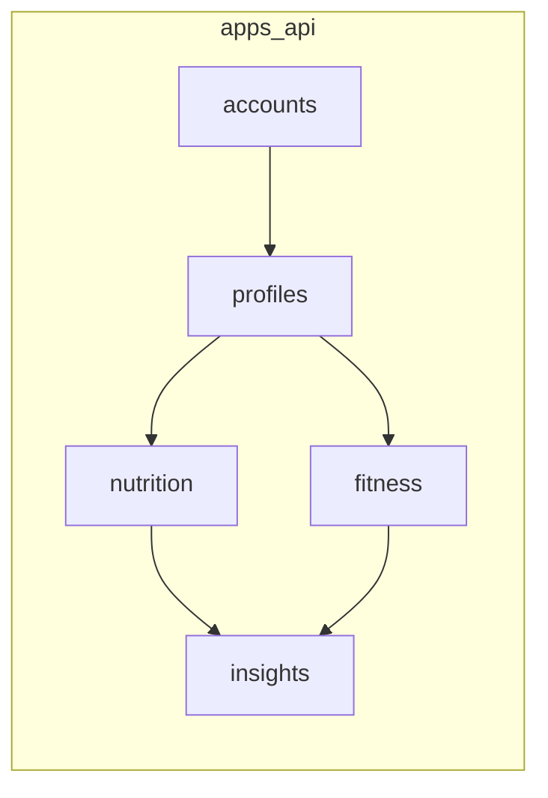

# Backend modules (Django)

Maps domain → planned Django apps under `apps/api/`.

| Module | Responsibility | Main models (planned) |
|--------|----------------|------------------------|
| `accounts` | Register, login, auth | User |
| `profiles` | Health profile, goals, BMI | HealthProfile, Goal |
| `nutrition` | Meals, food items, intake | Meal, FoodItem |
| `fitness` | Activities, calories out | Activity |
| `insights` | Progress reports, suggestions | ProgressReport |

Change this file when modules are renamed or split. Implement code only after models are settled in [class-domain.md](class-domain.md) and [database.md](database.md).
