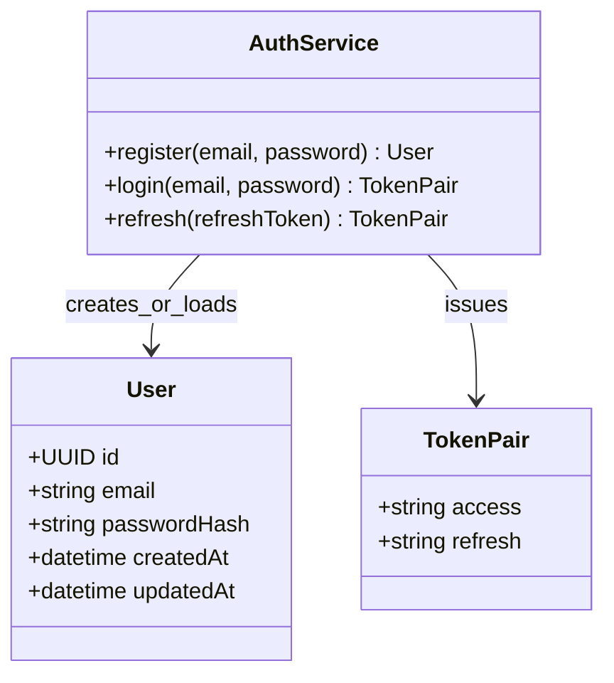

# Class 2 — Accounts / auth

Maps to Django app `accounts` + SimpleJWT.

## Django mapping

- `User` → custom user or `AbstractUser` with email as username.
- Tokens → `rest_framework_simplejwt` (not stored as our own model).
