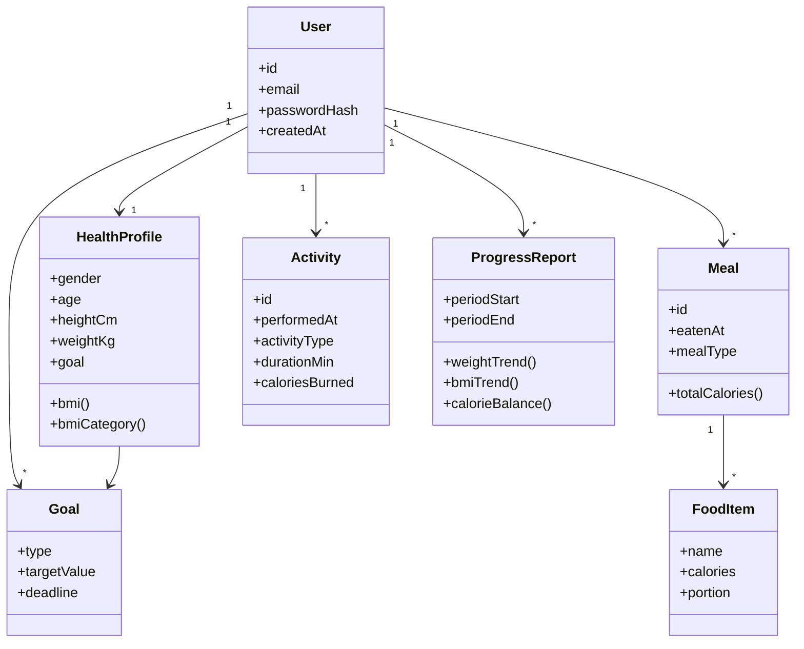

# Class — Domain model

**Status:** draft skeleton for session 3. Align attributes with TFIT research; keep Relapsa original.

## Notes

- `bmi()` / `bmiCategory()` are domain operations (see [../requirements/domain.md](../requirements/domain.md)).
- Suggestions can stay as application services later — not required on the class diagram for session 3.
