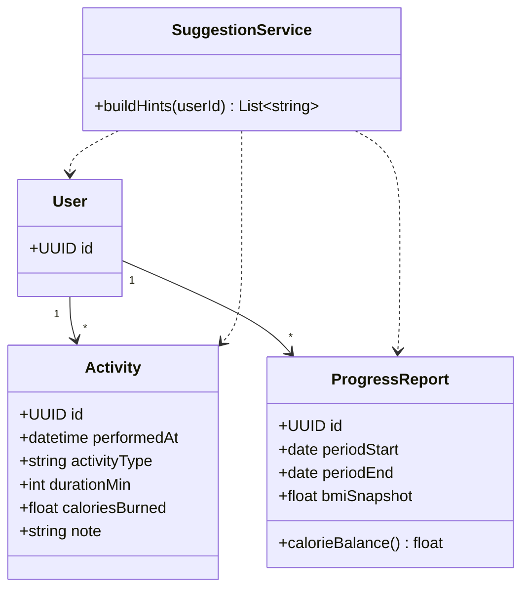

# Class 5 — Fitness & insights

Maps to Django apps `fitness` + `insights`.

## activityType values

`walk` · `run` · `gym` · `sport` · `other`

`SuggestionService` is application logic (not necessarily a DB table).
