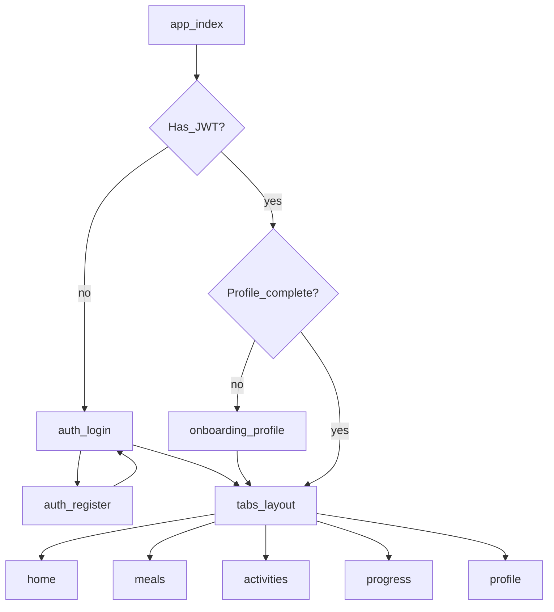

# Frontend flows (Expo Router)

| Screen | Route (Expo Router) | UC |
|--------|---------------------|-----|
| Login / Register | `app/(auth)/login.tsx`, `register.tsx` | UC1 |
| Onboarding profile | `app/onboarding/profile.tsx` | UC2 |
| Home | `app/(tabs)/index.tsx` | hub |
| Meals | `app/(tabs)/meals.tsx` | UC3 |
| Activities | `app/(tabs)/activities.tsx` | UC4 |
| Progress | `app/(tabs)/progress.tsx` | UC5 |
| Profile | `app/(tabs)/profile.tsx` | UC2 |

JWT in `expo-secure-store`. API base URL from env (`EXPO_PUBLIC_API_URL`).
