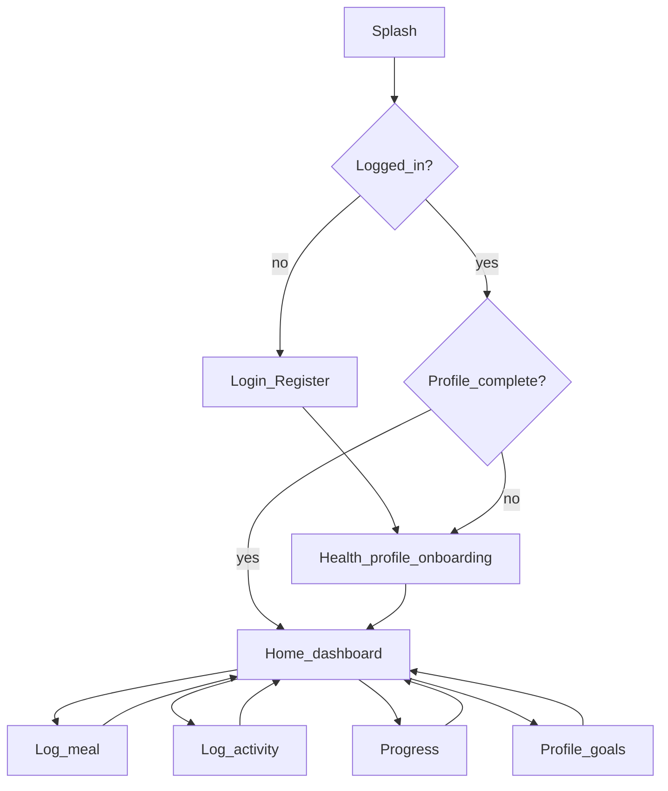

# Frontend flows (Expo)

Screen map for the Relapsa mobile client. Details follow activity diagrams.

| Screen | Purpose | Related activity doc |
|--------|---------|----------------------|
| Login / Register | FR1 | [activity-auth.md](activity-auth.md) |
| Onboarding profile | FR2, BMI | [activity-auth.md](activity-auth.md) |
| Home | Hub | — |
| Log meal | FR3 | [activity-meal.md](activity-meal.md) |
| Log activity | FR4 | [activity-fitness.md](activity-fitness.md) |
| Progress | FR5 | [activity-progress.md](activity-progress.md) |
| Profile / goals | FR2 | [activity-auth.md](activity-auth.md) |
