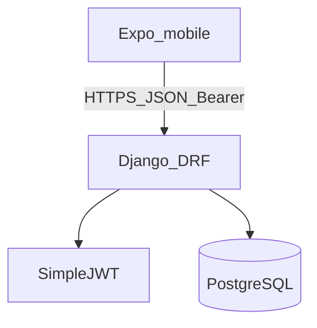

# System architecture

**Product:** Relapsa  
**Status:** frozen for MVP build.

## Bounded contexts

| Context | App | Responsibility |
|---------|-----|----------------|
| Identity | accounts | Register, login, JWT |
| Profile | profiles | Health metrics, goals, BMI |
| Nutrition | nutrition | Meals, food items |
| Fitness | fitness | Activities |
| Insights | insights | Progress, suggestions |

## Out of scope (semester)

Wearables, SMS OTP, trainers/live classes, Samsung-parity sensors.
