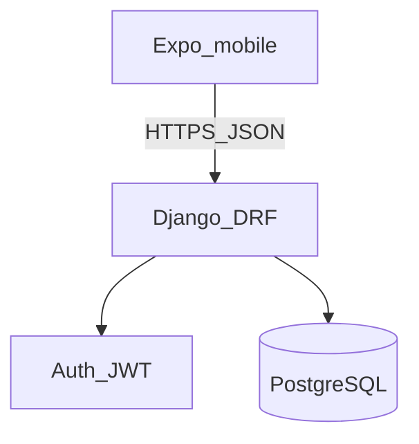

# System architecture

**Product:** Relapsa  
**Status:** planned (freeze before coding).

## Bounded contexts

| Context | Responsibility |
|---------|----------------|
| Identity & profile | Register, login, health profile, BMI |
| Nutrition | Meals, food items, intake calories |
| Fitness | Activities, burn calories |
| Insights | Progress, slips vs goals, suggestions, charts |

## Out of scope (semester)

- Wearable sync / Samsung-parity sensors
- Social feeds
- Full food barcode databases (optional later)
