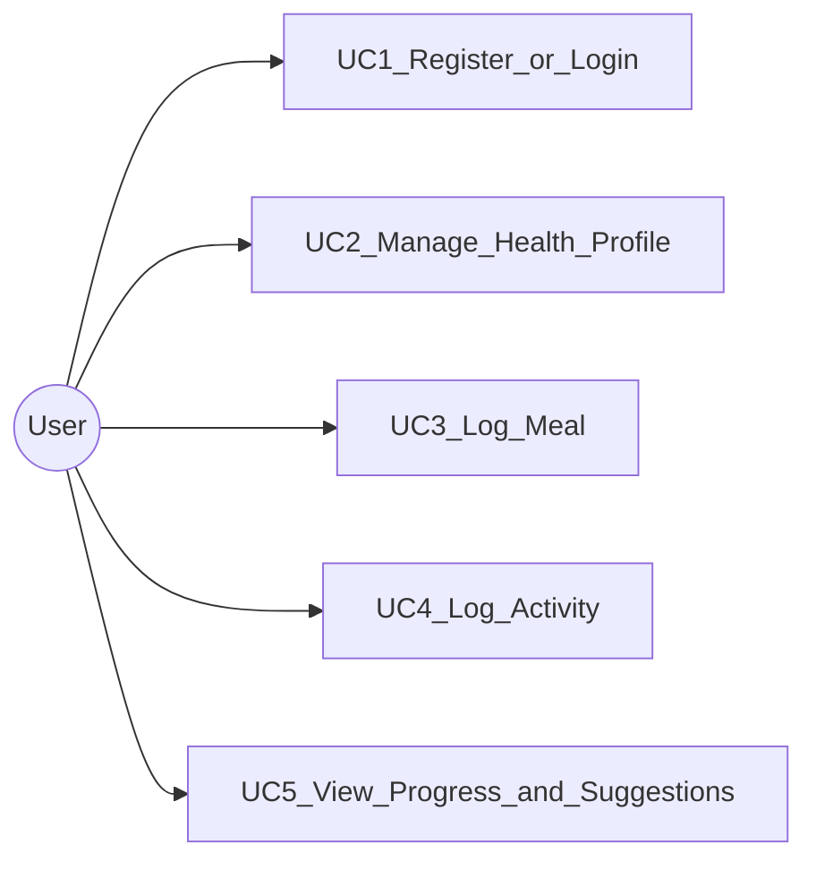

# Use cases (5)

Actor: **User**. Product: **Relapsa**.

## UC1 — Register or login

| | |
|--|--|
| **Goal** | Create an account or sign in and receive JWT tokens |
| **Preconditions** | App reachable; valid email/password |
| **Postconditions** | Access + refresh tokens issued; user identity known |
| **Main success** | 1) Open auth 2) Register or login 3) API returns JWT 4) Client stores tokens 5) Enter app |
| **FR** | FR1 |
| **Activity** | [activity-auth.md](activity-auth.md) |

## UC2 — Manage health profile

| | |
|--|--|
| **Goal** | Set/update gender, age, height, weight, goal; see BMI |
| **Preconditions** | Authenticated |
| **Postconditions** | HealthProfile saved; BMI and category available |
| **Main success** | 1) Open profile 2) Enter metrics + goal 3) Save 4) System computes BMI category |
| **FR** | FR2 |
| **Activity** | [activity-profile.md](activity-profile.md) |

## UC3 — Log meal

| | |
|--|--|
| **Goal** | Record a meal with food items and intake calories |
| **Preconditions** | Authenticated |
| **Postconditions** | Meal + FoodItems stored; total calories computed |
| **Main success** | 1) Choose meal type 2) Add foods/portions 3) Save 4) See meal calorie total |
| **FR** | FR3 |
| **Activity** | [activity-meal.md](activity-meal.md) |

## UC4 — Log activity

| | |
|--|--|
| **Goal** | Record a physical activity and calories burned |
| **Preconditions** | Authenticated |
| **Postconditions** | Activity stored with duration and calories out |
| **Main success** | 1) Choose activity type 2) Enter duration 3) Enter/estimate burn 4) Save |
| **FR** | FR4 |
| **Activity** | [activity-fitness.md](activity-fitness.md) |

## UC5 — View progress and suggestions

| | |
|--|--|
| **Goal** | See weight/BMI/calorie trends and basic suggestions |
| **Preconditions** | Authenticated; ideally some profile + logs |
| **Postconditions** | Report shown; optional suggestion text |
| **Main success** | 1) Open progress 2) Load profile + meals + activities 3) Charts/summary 4) Suggestion rules |
| **FR** | FR5 |
| **Activity** | [activity-progress.md](activity-progress.md) |
