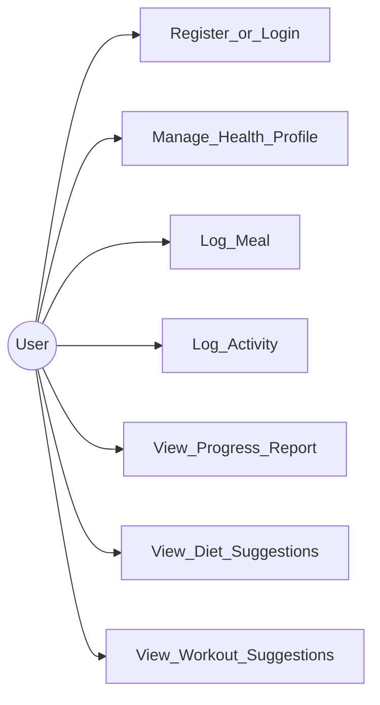

# Use cases

Actor: **User** (authenticated after register/login).

## Mapping to FRs

| Use case | FR |
|----------|-----|
| Register / Login | FR1 |
| Manage Health Profile | FR2 |
| Log Meal | FR3 |
| Log Activity | FR4 |
| View Progress / Suggestions | FR5 |
