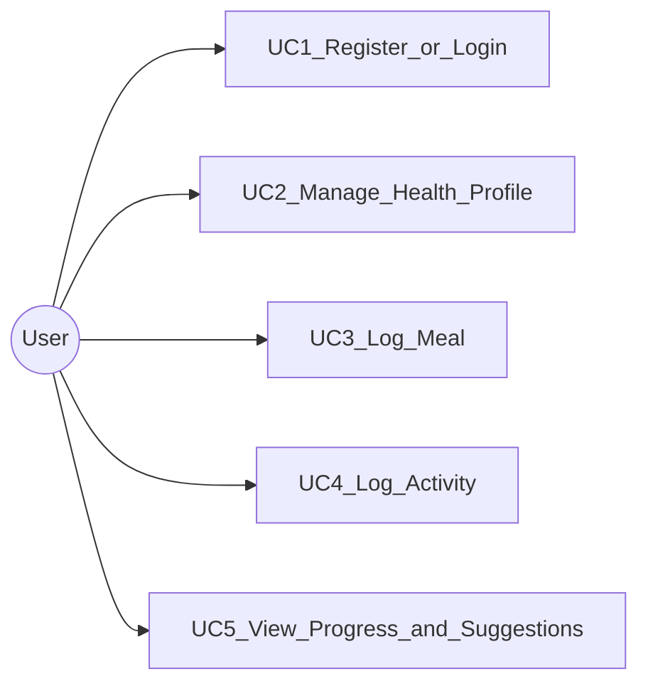

# Use cases

Actor: **User**.

## UC1 — Register or login

User creates an account or signs in to access Relapsa.

## UC2 — Manage health profile

User sets gender, age, height, weight, and goal; system computes BMI category.

## UC3 — Log meal

User records a meal (type + food items); system totals intake calories.

## UC4 — Log activity

User records a workout/activity; system records duration and calories burned.

## UC5 — View progress and suggestions

User opens reports (weight/BMI/calorie trends) and sees basic suggestions.

| UC | FR | Activity diagram |
|----|-----|------------------|
| UC1 | FR1 | [activity-auth.md](activity-auth.md) |
| UC2 | FR2 | [activity-auth.md](activity-auth.md) |
| UC3 | FR3 | [activity-meal.md](activity-meal.md) |
| UC4 | FR4 | [activity-fitness.md](activity-fitness.md) |
| UC5 | FR5 | [activity-progress.md](activity-progress.md) |
